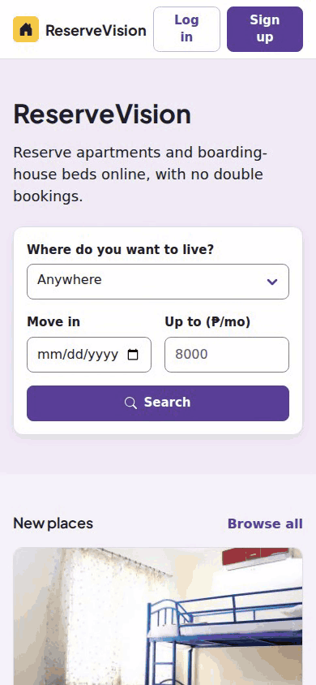
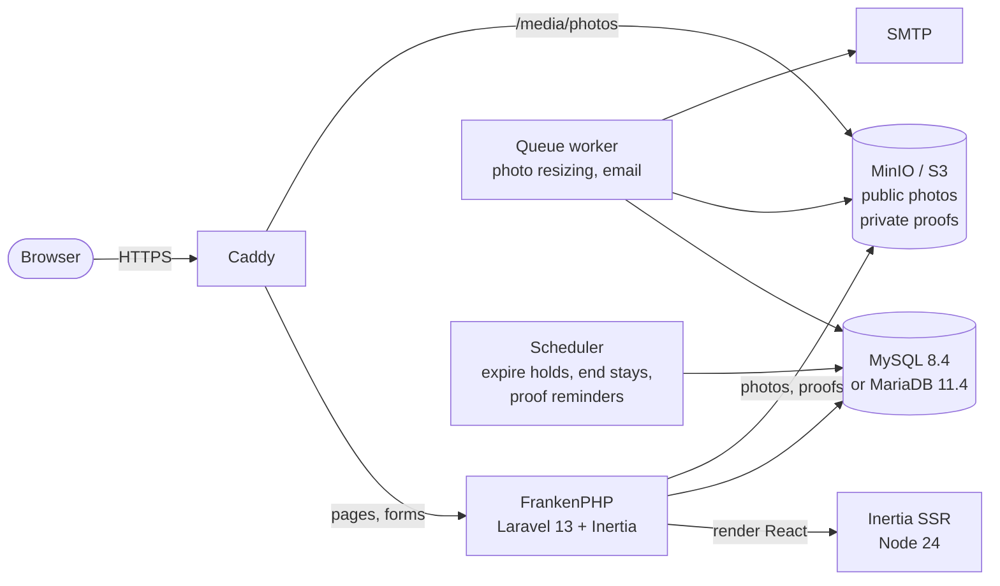

# ReserveVision

Reservations for apartments and boarding-house beds in the Philippines, for renters and the landlords who run them. The guarantee: no bed is ever booked twice, proven by tests that fire real parallel requests.

[](https://github.com/bienthehuman/reserve-vision/actions/workflows/tests-mysql.yml)
[](https://github.com/bienthehuman/reserve-vision/actions/workflows/tests-mariadb.yml)
[](https://github.com/bienthehuman/reserve-vision/actions/workflows/quality.yml)
[](https://github.com/bienthehuman/reserve-vision/actions/workflows/e2e.yml)
[](https://github.com/bienthehuman/reserve-vision/actions/workflows/production.yml)
[](https://github.com/bienthehuman/reserve-vision/actions/workflows/links.yml)

[](https://codespaces.new/bienthehuman/reserve-vision)

<p align="center">
  
</p>

## What it does

Renters search apartments, private rooms and beds in shared rooms by place, price and move-in date, and reserve one. The bed is held for 24 hours while they pay the reservation fee by GCash or bank transfer and upload the receipt. The landlord checks the proof and confirms, asks for a new one, or declines, and each decision reaches the other side by email. Many landlord accounts share the platform, each with owners and caretakers, and none can see another's data.

## Try it

**In the browser, with nothing installed:** [open it in GitHub Codespaces](https://codespaces.new/bienthehuman/reserve-vision). Setup runs inside the codespace and the app opens when it's ready (a few minutes). The login page lists the demo accounts: one tap fills in the form.

**Locally**, with Docker and Compose v2:

```bash
bin/setup
```

The app is at http://localhost:8180, and every email it sends lands in Mailpit at http://localhost:8126. It is safe to run again. Ports, test commands and the database users are in [CLAUDE.md](CLAUDE.md#environment).

The demo data is fake but realistic and the same on every run: 15 landlord accounts, 60 properties in 7 cities, about 390 spaces and 2,200 reservations in every status, with real public-domain photographs ([credits](database/data/demo-photos/CREDITS.md)). Every password is `password`; every email ends in `@example.com`.

| Login | Role | Use it for |
| --- | --- | --- |
| `owner@example.com` | Owner of **Santos Family Rentals** (verified, 5 properties) | Landlord flows: dashboard, editing, photos, decisions |
| `caretaker@example.com` | Caretaker in the **same** account | Role limits: decides on reservations, can't change rates or invite |
| `owner2@example.com` | Owner of **Cruz Lettings**, another account | Isolation: never sees the first account's data |
| `renter1@example.com`, `renter2@example.com` | Renters with no reservations | Racing for the last bed |

**Race for the last bed.** [Santos Bedspace House](http://localhost:8180/listings/manila/santos-bedspace-house) in Sampaloc, Manila, has a 4-bed **Last Bed Room** where beds A, B and C are taken from the 1st of next month, so exactly one is free. Log in as `renter1` and `renter2` in two browsers, choose that move-in date, and press Reserve in both at the same moment: one gets the hold, the other is told the room has no free space for those dates. [e2e/reserve.spec.ts](e2e/reserve.spec.ts) does the same.

To start over: `docker compose down -v && bin/setup`. Three landlord accounts are waiting for verification: `docker compose exec app php artisan landlord:verify --list`.

## Guarantees

Each guarantee links to the tests that prove it and names the CI check that runs them on every pull request. The races fire **real parallel HTTP requests** at a running 16-thread server, on MySQL and MariaDB, and each run proves from the server's own clock that the requests were inside it at the same time.

| Guarantee | Proven by | CI check |
| --- | --- | --- |
| **No space is ever double-booked**, even under simultaneous requests | [T1](tests/Concurrency/ReservationRaceTest.php#L114) (10 renters, one room: one hold), [T2](tests/Concurrency/ReservationRaceTest.php#L135) (6 renters, 4 beds: four holds on four beds), [T3, T4](tests/Feature/Reservations/OverlapTest.php) (back-to-back stays allowed, a one-day overlap refused), [T8b](tests/Concurrency/ReservationRaceTest.php#L160) and [T8](tests/Feature/Reservations/RenterLimitsTest.php) (a renter's hold limits, in parallel too), and the races against archiving a room ([ArchiveRaceTest](tests/Concurrency/ArchiveRaceTest.php)), between two landlord decisions or a decision and the renter's cancel ([DecisionRaceTest](tests/Concurrency/DecisionRaceTest.php)) | `MySQL 8.4 / Concurrency`, `MariaDB 11.4 / Concurrency`, `… / Pest` |
| **An expired hold never blocks a space**, even if the cleanup job hasn't run, and can't take a proof or be confirmed | [T5](tests/Feature/Reservations/ExpiredHoldTest.php) | `MySQL 8.4 / Pest`, `MariaDB 11.4 / Pest` |
| **A landlord can't see or probe another landlord's data**, on any route; a caretaker can't change rates, invite or withdraw | [T6](tests/Feature/Isolation/T6CrossAccessTest.php) (generated over every landlord and renter route: `404`, no data, every table unchanged), [T7](tests/Feature/Isolation/T7RoleLimitsTest.php) (`403`, nothing changed), the [permission-matrix doc test](tests/Feature/Docs/PermissionMatrixTest.php) (the table in [ACCESS.md](docs/ACCESS.md#permission-matrix) against the policies), and the invitation races ([MembersRaceTest](tests/Concurrency/MembersRaceTest.php)) | `… / Pest`, `… / Concurrency` |
| **Payment proofs are private**: links last 5 minutes and work only for the user they were made for | [T9](tests/Feature/Proofs/T9SignedProofUrlTest.php) (another renter, another account, a guest, an expired, tampered or revoked link: `403` or `404`, never the bytes) | `… / Pest` |
| **Search shows only beds that are really free**, by the same definition the booking uses | [T10](tests/Feature/Search/T10AvailabilityTest.php) (the query against a brute-force check over 410 combinations of date, length, price and place, edge reservations included) | `… / Pest` |
| **Public pages are readable without JavaScript** and pass axe | [T11](tests/Feature/Listings/T11ListingWithoutJsTest.php) (title, price and place in the raw HTML), and the JavaScript-off tests in [listings.spec.ts](e2e/listings.spec.ts) and [search.spec.ts](e2e/search.spec.ts) | `… / Pest`, `Playwright + axe` |
| **The whole flow works on a phone**, emails included | [T12](e2e/t12-full-flow.spec.ts) (search, reserve, log in, proof, the caretaker confirms; each email read from the mail server) | `Playwright + axe`, `Production stack` |
| **Every page passes axe** for every role that can open it | [The accessibility sweep](e2e/a11y-sweep.spec.ts), generated from the route list, so a new page without an entry fails it ([details](docs/perf/accessibility.md)) | `Playwright + axe`, `Production stack` |

T2 on the dev stack: six renters' requests are all inside the server at once; the room lock lets them through one at a time, so four get beds A to D and two are told there's no space. Each bar is one request, by the server's clock. Run it with `docker compose exec app composer test:concurrency`.


## Architecture

One Laravel application renders React pages through Inertia, server-side first; there is no separate API ([ADR 0002](docs/adr/0002-inertia-monolith.md)). The production stack is one Docker host ([DEPLOY.md](DEPLOY.md)):



- **Actions** hold the business rules: one `final` class per operation (`ReserveSpace`, `UploadPaymentProof`, `ConfirmReservation`…), each in one transaction with an explicit lock order. Controllers are thin: authorize, call one action, answer.
- **Policies** hold every authorization rule, and a test compares them with the permission matrix in [ACCESS.md](docs/ACCESS.md#permission-matrix).
- **Landlord isolation** is a fail-closed global scope on every landlord-owned model, a write guard, and a short list of named escapes that an architecture test enforces ([ACCESS.md](docs/ACCESS.md#how-it-works-slice-31)).
- **Least-privilege database users**: the app (and the test suite) connect as a user with no DDL; only migrations use the other one ([ADR 0008](docs/adr/0008-least-privilege-database-users.md)).
- **An append-only audit log** for every landlord action, enforced by database triggers the app user can't drop.
- **Every status change** goes through one transition table, which a test compares with the table in [RESERVATIONS.md](docs/RESERVATIONS.md#transition-table).

## Notable engineering

**The room lock, and the read snapshot.** Every reservation for a room queues at the room row (`SELECT … FOR UPDATE`), then checks and inserts. The trap: under InnoDB's default isolation, a plain `SELECT` before the lock fixes the transaction's snapshot, so a request that waited at the lock can still read the old data and double-book. Every read after the locks is therefore a locking read, and a test fails if a non-locking `SELECT` or a subquery creeps into `ReserveSpace`. [ADR 0001](docs/adr/0001-room-lock-vs-exclusion-constraint.md).

**Proving concurrency, not assuming it.** Client-side timings can't show that requests overlapped: a server that queues them still accepts every connection at once. So the reserve endpoint reports, in a test-only header that production ignores, when the server started and finished each request, and every race asserts that the last one started before the first one finished. Negative controls prove the suite can fail: with a lock and its locking reads removed, it double-books or breaks the renter's limits in every round. [ADR 0001, Evidence](docs/adr/0001-room-lock-vs-exclusion-constraint.md#evidence-slice-25).

**One definition of "free".** The search composes the same `blocking()` and `overlapping()` scopes the booking uses, filters everything in one SQL query, and runs in about 4 ms on the demo data with the existing indexes. The query, its `EXPLAIN ANALYZE` and why no index was added: [perf/availability-query.md](docs/perf/availability-query.md).

**Signed, user-bound proof links.** A proof is shown through a link valid for 5 minutes that names the user it was made for; the file route checks the signature, the user and the policy again, then streams the bytes from a private bucket with `Content-Security-Policy: sandbox`. A leaked link is useless to anyone else. [ADR 0011](docs/adr/0011-stream-private-proofs-through-php.md), [ACCESS.md](docs/ACCESS.md#private-files).

**Real places.** Every province, city and barangay comes from the Philippine Statistics Authority's PSGC list (about 42,000 barangays), bundled and imported in about 2 seconds, so search by place works and listing URLs stay stable across updates. [ADR 0010](docs/adr/0010-psgc-places-data.md).

**Fast on a cheap phone.** Lighthouse runs in CI against the production stack, on the mobile preset (simulated slow 4G, mid-range phone), median of 3 runs, and fails the pull request below the bar ([perf/lighthouse.md](docs/perf/lighthouse.md); numbers from [this CI run](https://github.com/bienthehuman/reserve-vision/actions/runs/44028626664)):

| Page | Performance | Accessibility | Best practices | SEO | LCP | CLS |
| --- | ---: | ---: | ---: | ---: | ---: | ---: |
| Home | 95 | 100 | 100 | 100 | 2.91 s | 0 |
| Search, Manila | 96 | 100 | 100 | 100 | 2.71 s | 0 |
| A listing | 92 | 100 | 100 | 100 | 3.40 s | 0 |
| Log in | 100 | 100 | 100 | not indexed | 0.61 s | 0 |

## A note on naming

In rental language a *tenant* is the person renting; in SaaS language a *tenant* is the customer organization. This codebase avoids the word entirely: **landlord account** (the customer), **landlord member** (owner or caretaker) and **renter**. See [ADR 0005](docs/adr/0005-no-word-tenant.md).

## Design docs and ADRs

- [Architecture](docs/ARCHITECTURE.md): stack, code organization, runtime, budgets
- [Data model](docs/DATA_MODEL.md), with an ERD
- [Access and isolation](docs/ACCESS.md): roles, the permission matrix, private files
- [Reservations](docs/RESERVATIONS.md): rules, lifecycle, concurrency, emails
- [Design system](docs/DESIGN_SYSTEM.md) ([palette preview](docs/design/preview.html))
- [Conventions](docs/CONVENTIONS.md) and the [build plan](docs/BUILD_PLAN.md), with the decisions log and the backlog
- Performance and accessibility: [Lighthouse](docs/perf/lighthouse.md), [the accessibility sweep](docs/perf/accessibility.md), [the availability query](docs/perf/availability-query.md)
- [Architecture decision records](docs/adr/README.md): 13 decisions, from the room lock to the place list

## Deploy

ReserveVision is deployable, not hosted: every pull request builds the production image, boots the production stack in CI with the same script a server uses, smoke-tests it and runs the end-to-end suite against it ([ADR 0007](docs/adr/0007-deployable-not-hosted.md)). To run it on your own server (one Docker host, automatic HTTPS, MySQL, S3-compatible storage), see [DEPLOY.md](DEPLOY.md).

## Out of scope

- **A payment gateway.** Renters upload proof of a GCash or bank transfer, which is how these fees are paid today; a gateway needs a registered business ([ADR 0003](docs/adr/0003-manual-payment-proof.md)).
- **Monthly rent billing and receipts** after move-in.
- **Chat, reviews and ratings.**
- **Government ID collection**: a privacy risk under the Data Privacy Act, for no gain here.
- **Native mobile apps**: the web app is built for phones first.
- **A map**: the listing shows the full address and an "Open in Maps" link, which keeps map scripts, tiles, API keys and typed coordinates off the slowest page ([ADR 0009](docs/adr/0009-no-map-in-v1.md)).

### Ideas

A few from the [full backlog](docs/BUILD_PLAN.md#backlog):

- Undo a mistaken decline while the bed is still free
- A reservation's history on its page, from the audit log
- Login and sign-up without JavaScript, like the listing pages
- Two-factor authentication and passkeys
- A Filipino translation
- An admin web UI for verifying landlord accounts ([ADR 0013](docs/adr/0013-landlord-verification-by-artisan-command.md))

## Origins

ReserveVision started as my college thesis in 2021: a reservation system for apartments and boarding houses, built in plain PHP, HTML, Bootstrap and MySQL. It worked, but the scope kept growing and the code had no structure, tests or version control. I hadn't learned Git yet.

This is a rebuild, five years later, in 2026, with what I've learned since. The scope is narrower. The rules about who can see what are written down and tested. Every change went through Git, a pull request and CI. And the thing the thesis could only hope for, that a bed can't be booked twice, is now something tests prove on every change.

<!--
Optional, for the author: a screenshot of the 2021 thesis version, or its ERD, next to today's.
Put the image in docs/media/ (for example docs/media/thesis-2021.png) and uncomment:

<p align="center">
  
</p>
-->

## License

[MIT](LICENSE)

Place names and codes (every province, city and municipality, and barangay) are from the Philippine Standard Geographic Code of the **Philippine Statistics Authority (PSA)**, 3rd quarter 2026 publication; see [database/data/psgc/README.md](database/data/psgc/README.md).
