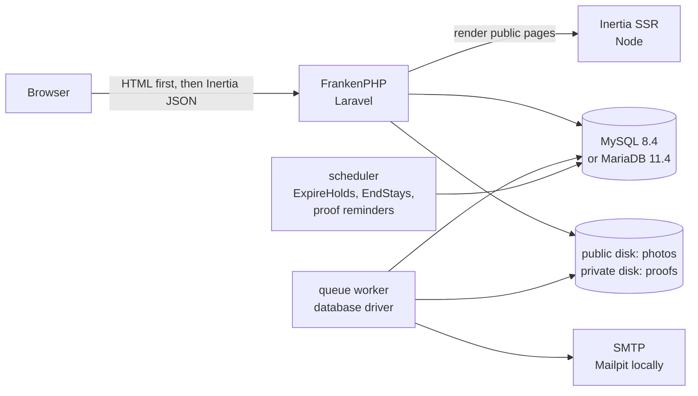

# Architecture

## Shape

One Laravel monolith that renders React pages through Inertia, with server-side rendering (SSR) for public pages. There's no separate API. See [ADR 0002](adr/0002-inertia-monolith.md).



| Layer | Choice | Pinned at |
| --- | --- | --- |
| Runtime | PHP 8.4 on FrankenPHP 1.13 (Docker image `dunglas/frankenphp:1.13-php8.4-bookworm`), Node 24 LTS | slice 1.1 |
| App | Laravel 13, Inertia 3 (inertia-laravel 3.7, @inertiajs/react 3.11), React 19.3, TypeScript 7.0 (`strict`), Vite 8 | slice 1.1 |
| Rendering | Inertia SSR for public pages (listings, search, home); client-only for authenticated dashboards. In dev the Vite dev server renders through `@inertiajs/vite` (`/__inertia_ssr`); in production `vite build --ssr` + `php artisan inertia:start-ssr`. Pages are code-split (`import.meta.glob`, not eager) | slice 1.1 |
| Styling | Bootstrap 5.3.9 via Sass with only the partials we use, React-Bootstrap 2.10, react-bootstrap-icons 1.11, a custom theme through Sass variables. See [ADR 0006](adr/0006-bootstrap-over-utility-first.md) | slice 1.1 |
| Database | MySQL 8.4 LTS (8.4.13 in dev; primary), MariaDB 11.4 LTS in the CI matrix | slice 1.1 |
| Queue | Laravel database driver | slice 1.1 |
| Files | `local`/`public` disks in dev; S3-compatible storage in production (MinIO in the production Compose file) | slice 1.3 |
| Images | PHP's GD extension (JPEG, PNG, WebP) plus `exif` for orientation, with no image library on top. Same in dev, CI and production; `app:doctor` checks it | slice 4.2 |
| Mail | Mailpit 1.33 in dev; any SMTP transactional provider in production | slice 1.1 |
| Maps | Leaflet + OSM tiles, one pin per property, loaded only on the listing page after interaction or in view; follows the OSM tile policy | slice 5.1 |
| Quality | Pest 5.3, Larastan 3.15 (level max, with a baseline only if forced), Pint 1.32, Vitest 5.1, Playwright 1.65 + axe-core 4.14. Installed and runnable locally in 1.1; CI in 1.2 | slice 1.2 |

**PHP server: FrankenPHP** (classic mode, not worker mode) instead of nginx + PHP-FPM. One process per container serves static files and PHP, so there's no supervisor and no nginx config to keep in sync, and the same image covers `app`, `worker` and `scheduler`. In production it serves plain HTTP behind a separate Caddy container, which terminates TLS (slice 1.3), so certificates and the proxy config stay out of the app image.

## Code organization

```
app/
  Actions/            one class per business operation: ReserveSpace, UploadPaymentProof, ConfirmReservation, ExpireHolds…
  Enums/              ReservationStatus (with the transition table), Role, PropertyKind…
  Exceptions/Domain/  NoSpaceAvailable, HoldLimitReached, InvalidTransition… mapped to 422 with a user-facing message
  Http/Controllers/   thin: authorize, call one action, return an Inertia page or redirect
  Http/Requests/      validation of shape only; business rules live in actions
  Jobs/               queued work; a job loads its record and calls actions (ProcessPropertyPhoto)
  Models/             Eloquent models, scopes, casts. No business logic
  Models/Concerns/    BelongsToLandlordAccount (global scope + creating hook)
  Policies/           every authorization rule
  Support/            CurrentLandlordAccount, Money
resources/js/
  Pages/              Inertia pages: Public/, Renter/, Landlord/
  Components/
resources/scss/       theme variables + the Bootstrap partials we import
```

Controllers don't touch the query builder for writes. Actions don't know about HTTP. The same layout as the B2B project, so the two Laravel repos read as one style.

## Runtime topology

| Service | Dev (`compose.yaml`) | Production (`compose.prod.yaml`) |
| --- | --- | --- |
| app | FrankenPHP (PHP 8.4), source mounted | Built image, OPcache, `php artisan optimize` |
| ssr | Vite dev server | `node bootstrap/ssr/app.js` (self-contained bundle, same image) |
| worker | `queue:work` | `queue:work --max-time=3600` |
| scheduler | `schedule:work` | `schedule:work` |
| db | MySQL 8.4 | MySQL 8.4, volume, `app` + `migrator` users |
| mail | Mailpit | external SMTP |
| storage | local disk (`MEDIA_STORAGE=local`) | MinIO (or any S3): public photos bucket, private proofs bucket |
| proxy | — | Caddy, automatic HTTPS; serves public photos at `/media/photos` |

`app`, `worker`, `scheduler` and `ssr` run one image ([Dockerfile](../Dockerfile)) with different commands. Only Caddy publishes ports. The dev container (Codespaces) runs the dev stack with built assets and the production SSR bundle instead of the Vite dev server. Details: [DEPLOY.md](../DEPLOY.md) and [CLAUDE.md](../CLAUDE.md#production-stack-slice-13).

**Photos** (slice 4.2). An owner's upload is checked by its content, copied to the private disk (which `app` and `worker` both reach; they are separate containers in production), and a `processing` row is saved; the queued `ProcessPropertyPhoto` job then applies the EXIF orientation, re-encodes the pixels as a 480 px thumbnail and a 1600 px full size in WebP on the public disk (which drops every piece of metadata, GPS included), deletes the upload and marks the row `ready`, or `failed` after three tries. Photos are served from `/media/photos/…` on the app's own origin in every environment: a route in dev, Caddy in front of the bucket in production.

**Deployable, not hosted** ([ADR 0007](adr/0007-deployable-not-hosted.md)). On every PR to `main`, CI builds the production image, boots `compose.prod.yaml` with `deploy.sh`, runs migrations as `migrator`, runs `php artisan app:doctor`, and seeds the demo data (`APP_DEMO=true`, throwaway env only), smoke-tests the home and login pages over HTTP (SSR, security headers, session cookie flags, no dev pages) and logs in as a demo owner with a CSRF token, then runs the Playwright + axe suite against it. A public listing page (slice 5.1) joins the smoke test when it exists. The deploy path is proven continuously even without a live host.

## Production constraints from the first slice

- **Least-privilege database users** ([ADR 0008](adr/0008-least-privilege-database-users.md)). Tests run as `app` too, so a missing grant fails in CI, not in production.
- **Security headers** via middleware: CSP (with an SSR nonce), HSTS in production, `X-Frame-Options: DENY`, `Referrer-Policy: strict-origin-when-cross-origin`, `Permissions-Policy`. A test asserts them.
- **Accessibility gate**: Playwright + axe on every page in the smoke suite; any violation fails CI.
- **Realistic data**: the demo seeder (15 landlords, 60 properties, about 400 spaces, several thousand historical reservations) is also used by the performance check of the availability query.
- **Rate limits**: login (5 a minute per email + IP), registration and password-reset emails (3 a minute per IP), all answered as a form error in the project's voice, not a 429 page (slice 2.4); `ReserveSpace` and proof upload later.
- **Sessions**: database driver; regenerated on login, invalidated on logout; the cookie is `HttpOnly`, `SameSite=Lax`, and `Secure` in production (`SESSION_SECURE_COOKIE`, default on when `APP_ENV=production`). `bin/smoke-production` checks the flags.

## Time

`APP_TIMEZONE` stays `UTC`, so timestamps are stored and compared in UTC. Business "today" (move-in window, `MarkMovedIn`, `EndStays`) comes from one helper, `BusinessDate::today()`, which uses `Asia/Manila`. Lease dates are plain dates with no timezone. Tests freeze time through this helper, including around midnight in Manila.
