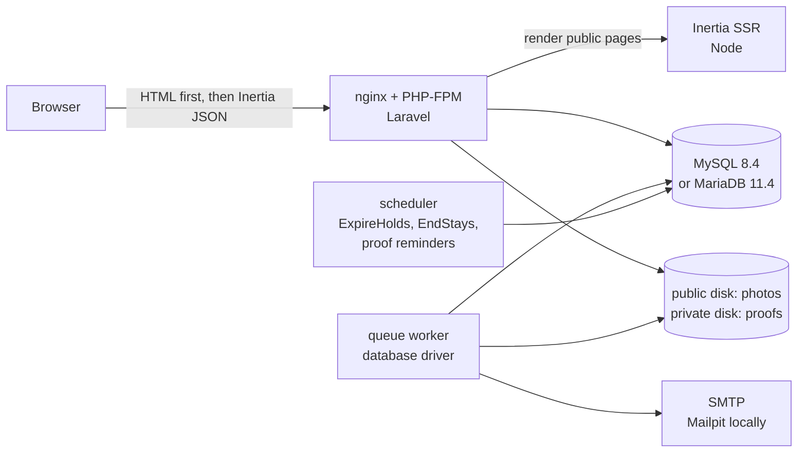

# Architecture

## Shape

One Laravel monolith that renders React pages through Inertia, with server-side rendering (SSR) for public pages. There's no separate API. See [ADR 0002](adr/0002-inertia-monolith.md).



| Layer | Choice | Pinned at |
| --- | --- | --- |
| Runtime | PHP 8.4 (Docker image), Node 24 LTS | slice 1.1 |
| App | Laravel (current major), Inertia, React, TypeScript | slice 1.1 |
| Rendering | Inertia SSR for public pages (listings, search, home); client-only for authenticated dashboards | slice 1.1 |
| Styling | Bootstrap 5 via Sass with only the partials we use, React-Bootstrap, a custom theme through Sass variables. See [ADR 0006](adr/0006-bootstrap-over-utility-first.md) | slice 1.1 |
| Database | MySQL 8.4 LTS (primary), MariaDB 11.4 LTS in the CI matrix | slice 1.1 |
| Queue | Laravel database driver | slice 1.1 |
| Files | `local`/`public` disks in dev; S3-compatible storage in production (MinIO in the production Compose file) | slice 1.3 |
| Mail | Mailpit in dev; any SMTP transactional provider in production | slice 1.1 |
| Maps | Leaflet + OSM tiles, one pin per property, loaded only on the listing page after interaction or in view; follows the OSM tile policy | slice 5.1 |
| Quality | Pest, Larastan (level max, with a baseline only if forced), Pint, Vitest, Playwright + axe-core | slice 1.2 |

## Code organization

```
app/
  Actions/            one class per business operation: ReserveSpace, UploadPaymentProof, ConfirmReservation, ExpireHolds…
  Enums/              ReservationStatus (with the transition table), Role, PropertyKind…
  Exceptions/Domain/  NoSpaceAvailable, HoldLimitReached, InvalidTransition… mapped to 422 with a user-facing message
  Http/Controllers/   thin: authorize, call one action, return an Inertia page or redirect
  Http/Requests/      validation of shape only; business rules live in actions
  Models/             Eloquent models, scopes, casts. No business logic
  Models/Concerns/    BelongsToLandlordAccount (global scope + creating hook)
  Policies/           every authorization rule
  Support/            CurrentLandlordAccount, Money
resources/js/
  Pages/              Inertia pages: Public/, Renter/, Landlord/
  Components/
resources/scss/       theme variables + the Bootstrap partials we import
```

Controllers don't touch the query builder for writes. Actions don't know about HTTP. The same layout as the B2B project, so the two Laravel repos read as one style.

## Runtime topology

| Service | Dev (`compose.yaml`) | Production (`compose.prod.yaml`) |
| --- | --- | --- |
| app | PHP-FPM + nginx, source mounted | Built image, OPcache, `php artisan optimize` |
| ssr | Vite dev server | `php artisan inertia:start-ssr` |
| worker | `queue:work` | `queue:work` with `--max-time` |
| scheduler | `schedule:work` | `schedule:work` |
| db | MySQL 8.4 | MySQL 8.4, volume, `app` + `migrator` users |
| mail | Mailpit | external SMTP |
| storage | local disk | MinIO (or any S3) |
| proxy | — | Caddy, automatic HTTPS |

**Deployable, not hosted** ([ADR 0007](adr/0007-deployable-not-hosted.md)). CI builds the production image, boots `compose.prod.yaml`, runs migrations as `migrator`, and smoke-tests a listing page and login over HTTP on every PR to `main`. The deploy path is proven continuously even without a live host.

## Production constraints from the first slice

- **Least-privilege database users** ([ADR 0008](adr/0008-least-privilege-database-users.md)). Tests run as `app` too, so a missing grant fails in CI, not in production.
- **Security headers** via middleware: CSP (with an SSR nonce), HSTS in production, `X-Frame-Options: DENY`, `Referrer-Policy: strict-origin-when-cross-origin`, `Permissions-Policy`. A test asserts them.
- **Accessibility gate**: Playwright + axe on every page in the smoke suite; any violation fails CI.
- **Realistic data**: the demo seeder (15 landlords, 60 properties, about 400 spaces, several thousand historical reservations) is also used by the performance check of the availability query.
- **Rate limits**: login, registration, `ReserveSpace` and proof upload.

## Time

`APP_TIMEZONE` stays `UTC`, so timestamps are stored and compared in UTC. Business "today" (move-in window, `MarkMovedIn`, `EndStays`) comes from one helper, `BusinessDate::today()`, which uses `Asia/Manila`. Lease dates are plain dates with no timezone. Tests freeze time through this helper, including around midnight in Manila.
