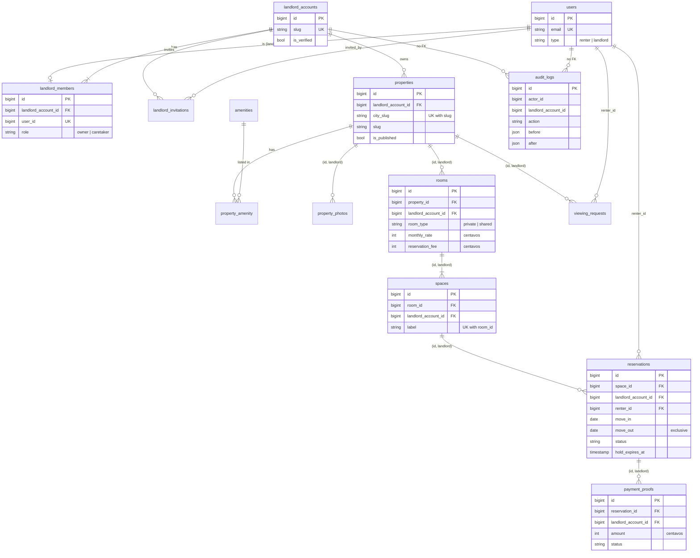

# Data model

The source of truth for the schema. Migrations must match it.

## Conventions

- **Money** is unsigned integer **centavos** (`reservation_fee = 150000` is ₱1,500.00). There are no floats anywhere.
- **Lease dates** (`move_in`, `move_out`) are `DATE` columns. `move_out` is exclusive. Moments (`hold_expires_at`, `decided_at`) are `TIMESTAMP` columns stored in UTC. The app timezone for "today" is `Asia/Manila`.
- **Enums** are `VARCHAR` columns with a `CHECK` constraint, mirrored by a PHP backed enum. This avoids MySQL `ENUM` migration pain and works on both MySQL 8 and MariaDB.
- **Landlord ownership is denormalized.** `rooms`, `spaces` and `reservations` carry `landlord_account_id`, kept consistent with **composite foreign keys**: `(property_id, landlord_account_id)` references `properties (id, landlord_account_id)`, and so on down the chain. The database itself then guarantees a room can't belong to a different landlord than its property. The isolation scope becomes a plain indexed `WHERE` with no joins.
- **No hard deletes** of anything a reservation points to. Properties, rooms and spaces are archived (`archived_at`) instead.

## Tables

`*` marks a column added to the scope document's model; the reason is in the Notes column.

### Accounts and people

| Table | Columns | Constraints / notes |
| --- | --- | --- |
| `users` | id, first_name, middle_name, last_name, suffix, email, phone, type, password, email_verified_at, timestamps | `first_name` and `last_name` are required; `middle_name` and `suffix` are optional. `suffix` is `VARCHAR(8)` validated by the `NameSuffix` enum and the form, with **no CHECK** (see [CONVENTIONS](CONVENTIONS.md#names)). `phone` is a Philippine mobile number stored normalized as `09XXXXXXXXX` (`App\Support\PhilippineMobile`; registration accepts `+63…`, spaces and dashes). `type IN ('renter','landlord')`, default `renter`. One user is one type; a landlord who wants to rent uses a second account (decision to check). Unique email |
| `landlord_accounts` | id, name, slug, contact_phone, is_verified, verified_at\*, timestamps | Unique slug. `is_verified` is set by `php artisan landlord:verify {slug}`. Only verified accounts can publish |
| `landlord_members` | id, landlord_account_id, user_id, role, timestamps | `role IN ('owner','caretaker')`. **Unique `user_id`**: a landlord user belongs to exactly one account, which makes "current account" unambiguous. At least one owner per account, enforced in `RemoveMember` |
| `landlord_invitations`\* | id, landlord_account_id, email, role, token_hash, invited_by, expires_at, accepted_at, revoked_at, timestamps | Needed for caretaker invites. The token is stored hashed and expires after 7 days. Correction: owner revokes |

### Listings

| Table | Columns | Constraints / notes |
| --- | --- | --- |
| `properties` | id, landlord_account_id, kind, name, slug, city, city_slug\*, barangay, address, lat, lng, gender_policy, house_rules, is_published, archived_at\*, timestamps | `kind IN ('apartment','boarding_house')`, `gender_policy IN ('any','male_only','female_only')`. Unique `(city_slug, slug)` for `/listings/{city}/{slug}`. Unique `(id, landlord_account_id)` as the composite FK target. `lat`/`lng` are `DECIMAL(9,6)`, nullable, with range CHECKs (±90, ±180). Index `(landlord_account_id, is_published)` |
| `amenities` | id, name, slug | Seeded catalogue |
| `property_amenity` | property_id, amenity_id | Composite PK |
| `property_photos` | id, property_id, landlord_account_id\*, path, sort, status\*, timestamps | `status IN ('processing','ready','failed')`. Set by the resize job. Public disk |
| `rooms` | id, property_id, landlord_account_id\*, name, room_type, monthly_rate, deposit_months, advance_months, reservation_fee\*, archived_at\*, timestamps | `room_type IN ('private','shared')`. `monthly_rate > 0`, `reservation_fee >= 0`, `deposit_months` and `advance_months` 0–3. `reservation_fee` was missing from the scope document (`$room->reservationFee()`) |
| `spaces` | id, room_id, landlord_account_id\*, label, archived_at\*, timestamps | Unique `(room_id, label)`. A private room has exactly one space; enforced in the action, not the database |

### Reservations

| Table | Columns | Constraints / notes |
| --- | --- | --- |
| `reservations` | id, space_id, landlord_account_id\*, renter_id, move_in, move_out, status, reservation_fee, hold_expires_at, proof_rejections\*, decided_by, decided_at, decision_reason\*, cancelled_by\*, cancelled_at\*, fee_refunded\*, refund_note\*, timestamps | `CHECK (move_in < move_out)`, `CHECK (status IN (…8 statuses…))`, `CHECK (proof_rejections BETWEEN 0 AND 2)`. **Index `(space_id, status, move_in, move_out)`** for overlap checks and availability search. Index `(renter_id, status)` for the open-reservation limits. Index `(landlord_account_id, status)` for the dashboard. Index `(status, hold_expires_at)` for the `ExpireHolds` job. Unique `(id, landlord_account_id)` as the composite FK target of `payment_proofs` |
| `payment_proofs` | id, reservation_id, landlord_account_id\*, path, amount, reference_no, status\*, reviewed_by\*, reviewed_at\*, rejection_reason\*, uploaded_at | `status IN ('pending','accepted','rejected')`. Several rows per reservation, because a rejected proof is kept and a new one uploaded. Private disk. `amount` is in centavos as the renter typed it |
| `viewing_requests` | id, property_id, landlord_account_id\*, renter_id, preferred_at, status, landlord_note, decided_by\*, timestamps | `status IN ('requested','accepted','declined','done','cancelled'*)`. `cancelled` lets the renter withdraw |
| `audit_logs` | id, actor_id, landlord_account_id, action, subject_type, subject_id, before (JSON), after (JSON), created_at | **Append-only**, enforced by `BEFORE UPDATE` and `BEFORE DELETE` triggers (see below). There's no `updated_at`. `actor_id` is null for system actions. No foreign keys: history must not block, or be changed by, changes to what it describes |

## Write actions and their correction paths

Each write action lists how a mistake is undone, so no flow is a dead end.

| Write action | Who | Correction path |
| --- | --- | --- |
| Create or edit property, room, space | owner | Edit again; archive instead of delete. Rates already snapshotted on reservations don't change |
| Archive room or space | owner | Unarchive. Archiving is blocked while a blocking reservation exists on it |
| Publish property | owner | Unpublish. Existing reservations are unaffected |
| Upload photo | owner | Delete photo, reorder |
| Invite caretaker | owner | Revoke the invite; remove the member |
| Remove member | owner | Re-invite. The last owner can't be removed |
| Reservation transitions | see [RESERVATIONS.md](RESERVATIONS.md#correction-paths) | see there |
| Viewing request | renter | Renter cancels. Landlord's accept or decline can be changed until `preferred_at` passes |
| Verify landlord account | operator (CLI) | `landlord:verify --revoke {slug}` unpublishes all of the account's properties |

## Invariants enforced by the database

| Invariant | How |
| --- | --- |
| A room, space, reservation or proof belongs to the same landlord as its property | Composite foreign keys |
| `move_in < move_out`, non-negative money, valid statuses | `CHECK` constraints (MySQL ≥ 8.0.16, MariaDB ≥ 10.2), all named (`reservations_move_in_before_move_out`, `<table>_<column>_valid` for enums). A test compares each enum CHECK with its PHP enum |
| Audit log can't be edited or deleted | Triggers on `audit_logs` reject `UPDATE` and `DELETE` (`SQLSTATE 45000`). `app` has no `TRIGGER` or `DROP` privilege, so it can't remove them or `TRUNCATE`. Needs `log_bin_trust_function_creators=1` on the server; see [ADR 0008](adr/0008-least-privilege-database-users.md) |
| The app can't change the schema | Separate `migrator` and `app` DB users; see [ADR 0008](adr/0008-least-privilege-database-users.md) |
| No two blocking reservations overlap on a space | **Not expressible** in MySQL or MariaDB. Enforced by the room lock in `ReserveSpace`; see [ADR 0001](adr/0001-room-lock-vs-exclusion-constraint.md) and tests 1–4 |

## Entity relationships

Every `landlord_account_id` below the dotted boundary of `properties` is the denormalized owner, tied to its parent by a composite foreign key. `audit_logs` has no foreign keys on purpose.

## Audit log protection

`audit_logs` is created by `migrator` together with two triggers, `audit_logs_no_update` and `audit_logs_no_delete`, that `SIGNAL SQLSTATE '45000'` (driver error 1644 on both engines). `app` keeps the schema-wide `SELECT, INSERT, UPDATE, DELETE` grant, but the triggers reject its `UPDATE` and `DELETE` (including `REPLACE` and `ON DUPLICATE KEY UPDATE` on an existing row). It has no `TRIGGER` privilege, so it can't drop them, and no `DROP` privilege, so it can't `TRUNCATE`. `app:doctor` proves it on every deploy by attempting an `UPDATE` inside a rolled-back transaction. Why triggers and not grants or a second schema: [ADR 0008](adr/0008-least-privilege-database-users.md).

## Where the implementation differs from the first draft (slice 2.1)

| Difference | Why |
| --- | --- |
| People's names are `first_name` + optional `middle_name` + `last_name` + optional `suffix` instead of the single `name` the framework ships | "Joshua Gonzales" and "Joshua Gonzales Jr." are common in the Philippines and are different people. The migration splits any existing `name` at its last space (a fresh install has none) and `down()` joins them back. `suffix` is the one enum column without a CHECK: it is display data, so a new value shouldn't need a migration |
| `users.type` has `DEFAULT 'renter'` | The column is added to a table that may already hold rows; a `NOT NULL` column without a default would leave `''`, which the CHECK rejects. Registration always sets it explicitly |
| `properties.lat` and `lng` are nullable, with range CHECKs | A listing may be created before it is placed on a map; the draft didn't say |
| `landlord_invitations.token_hash` is `CHAR(64)` (SHA-256 hex), unique | The token is high-entropy, so a fast hash is enough and lookups by hash need no per-row work |
| `landlord_invitations.role` allows `owner` and `caretaker` | Same CHECK as `landlord_members.role`; `InviteCaretaker` (a later slice) decides what may be invited |
| Extra indexes: `reservations (status, hold_expires_at)`, `properties (landlord_account_id, is_published)`, `rooms (landlord_account_id, property_id)`, `viewing_requests (landlord_account_id, status)` and `(renter_id, status)`, `property_photos (property_id, sort)` | Queries the plan already names: the expiry job, the dashboard, the photo gallery |
| `audit_logs` has no foreign keys | History must outlive and never block changes to what it describes |
| Money columns are `INT UNSIGNED` | Up to ₱42.9 million per amount, with no `BIGINT` needed. An unsigned column refuses a negative value (error 1264) before any CHECK runs; the `>= 0` CHECKs stay as documentation of intent |
| `payment_proofs`, `viewing_requests` and `property_photos` carry `landlord_account_id` with a composite FK like the rest | The draft listed it with `*`; the chain is now complete |
