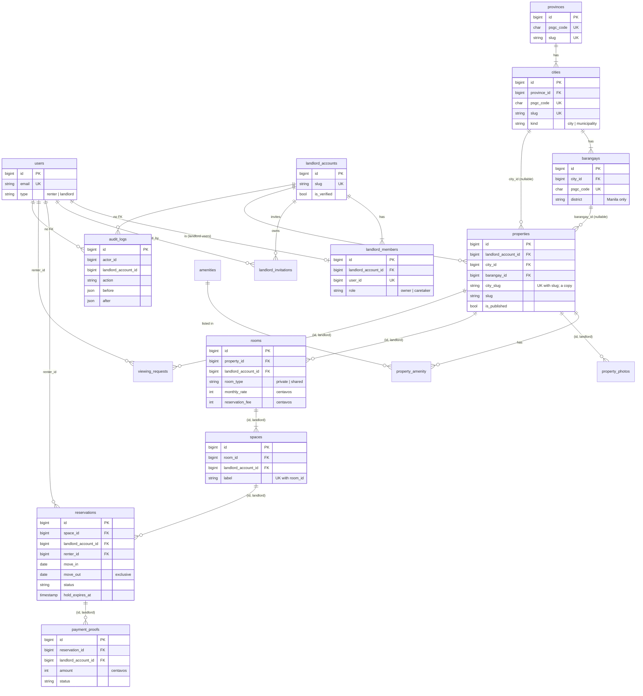

# Data model

The source of truth for the schema. Migrations must match it.

## Conventions

- **Money** is unsigned integer **centavos** (`reservation_fee = 150000` is ₱1,500.00). There are no floats anywhere.
- **Lease dates** (`move_in`, `move_out`) are `DATE` columns. `move_out` is exclusive. Moments (`hold_expires_at`, `decided_at`) are `TIMESTAMP` columns stored in UTC. The app timezone for "today" is `Asia/Manila`.
- **Enums** are `VARCHAR` columns with a `CHECK` constraint, mirrored by a PHP backed enum. This avoids MySQL `ENUM` migration pain and works on both MySQL 8 and MariaDB.
- **Landlord ownership is denormalized.** `rooms`, `spaces` and `reservations` carry `landlord_account_id`, kept consistent with **composite foreign keys**: `(property_id, landlord_account_id)` references `properties (id, landlord_account_id)`, and so on down the chain. The database itself then guarantees a room can't belong to a different landlord than its property. The isolation scope becomes a plain indexed `WHERE` with no joins.
- **No hard deletes** of anything a reservation points to. Properties, rooms and spaces are archived (`archived_at`) instead.

## Tables

`*` marks a column added to the scope document's model; the reason is in the Notes column.

### Accounts and people

| Table | Columns | Constraints / notes |
| --- | --- | --- |
| `users` | id, first_name, middle_name, last_name, suffix, email, phone, type, password, email_verified_at, timestamps | `first_name` and `last_name` are required; `middle_name` and `suffix` are optional. `suffix` is `VARCHAR(8)` validated by the `NameSuffix` enum and the form, with **no CHECK** (see [CONVENTIONS](CONVENTIONS.md#names)). `phone` is a Philippine mobile number stored normalized as `09XXXXXXXXX` (`App\Support\PhilippineMobile`; registration accepts `+63…`, spaces and dashes). `type IN ('renter','landlord')`, default `renter`. One user is one type; a landlord who wants to rent uses a second account (decision to check). Unique email |
| `landlord_accounts` | id, name, slug, contact_phone, is_verified, verified_at\*, timestamps | Unique slug. `is_verified` is set by `php artisan landlord:verify {slug}`. Only verified accounts can publish |
| `landlord_members` | id, landlord_account_id, user_id, role, timestamps | `role IN ('owner','caretaker')`. **Unique `user_id`**: a landlord user belongs to exactly one account, which makes "current account" unambiguous. At least one owner per account, enforced in `RemoveMember`, which locks all of the account's member rows first. Removing deletes the row (the audit log keeps who and when); the user stays, without a membership |
| `landlord_invitations`\* | id, landlord_account_id, email, role, token_hash, invited_by, expires_at, accepted_at, revoked_at, timestamps | Needed for caretaker invites. The token is stored hashed and expires after 7 days. **Pending** means `accepted_at` and `revoked_at` are null and `expires_at` is in the future; only a pending invitation can be accepted. Sending it again replaces `token_hash` and moves `expires_at` (also for an expired one); cancelling sets `revoked_at`; accepting sets `accepted_at` and creates the member with the invitation's `role`. Correction: owner revokes |

### Listings

| Table | Columns | Constraints / notes |
| --- | --- | --- |
| `properties` | id, landlord_account_id, kind, name, slug, address, barangay, city, city_slug\*, province\*, city_id\*, barangay_id\*, gender_policy, house_rules, payment_instructions\*, is_published, first_published_at\*, archived_at\*, timestamps | `kind IN ('apartment','boarding_house')`, `gender_policy IN ('any','male_only','female_only')`. Unique `(city_slug, slug)` for `/listings/{city}/{slug}`. Unique `(id, landlord_account_id)` as the composite FK target. **The address is four parts, in the order it is written in the Philippines:** `address` (the street address: house or building number and street; the one optional part, nullable), `barangay`, `city` and `province` (all `NOT NULL`). Since slice 4.4 the place is **linked**: `city_id` and `barangay_id` point at the [places tables](#places-slice-44), and `barangay`, `city`, `city_slug` and `province` are **copies** of the linked rows (the barangay with its district in Manila: "Barangay 395, Sampaloc"), written only by the property actions through `App\Support\Places\AddressCopies`. The copies stay because lists, `full_address`, the listing URL and its unique key `(city_slug, slug)` read them without a join. The links are nullable for rows from before 4.4 that `places:import` couldn't link; the form and publishing require both. `$property->full_address` joins the parts. There are no coordinates: `lat`/`lng` were dropped after 4.2 (nobody types coordinates, and no page used them). Index `(landlord_account_id, is_published)`. `payment_instructions` (text, null while a draft) is where the renter sends the reservation fee, e.g. "GCash 0917 123 4567 (J. Santos) or BPI 1234-5678-90"; the hold page and email show it (ACCESS flow B), and publishing requires it (4.3). `first_published_at` is set the first time the property is published and never cleared (4.3 sets it): from then on the public URL `/listings/{city_slug}/{slug}` exists, so **`slug` and `city` are locked** (`UpdateProperty`). `landlord:verify --revoke` and archiving unpublish but don't clear it |
| `amenities` | id, name, slug | Seeded catalogue |
| `property_amenity` | property_id, amenity_id | Composite PK |
| `property_photos` | id, property_id, landlord_account_id\*, path, alt\*, width\*, height\*, sort, status\*, timestamps | `status IN ('processing','ready','failed')`, set by the resize job (through `ResizePropertyPhoto` / `FailPropertyPhoto`). `path` is a random stem, `properties/<uuid>`: the files are `<path>-thumb.webp` (480 px wide) and `<path>-full.webp` (at most 1600 px on the long side) on the public `photos` disk, and the upload waits at `uploads/tmp/<uuid>` on the private `proofs` disk until the job has run. `alt` (160, nullable) is the owner's description; null shows as "Photo N of <property>". `width` and `height` are the full size's, set when ready, so pages can reserve the space. `sort` is 1, 2, 3… within a property; 1 is the cover. At most 12 per property, in any status (the action, not the database) |
| `rooms` | id, property_id, landlord_account_id\*, name, room_type, monthly_rate, deposit_months, advance_months, reservation_fee\*, archived_at\*, timestamps | `room_type IN ('private','shared')`. `monthly_rate > 0`, `reservation_fee >= 0`, `deposit_months` and `advance_months` 0–3. `reservation_fee` was missing from the scope document (`$room->reservationFee()`) |
| `spaces` | id, room_id, landlord_account_id\*, label, archived_at\*, timestamps | Unique `(room_id, label)`. A private room has exactly one space; enforced in the action, not the database |

### Places (slice 4.4)

Every province, city and municipality, and barangay of the PSA's **PSGC** (Philippine Standard Geographic Code), shipped in [database/data/psgc/](../database/data/psgc/README.md) and loaded by `php artisan places:import`. **Reference tables**: no `landlord_account_id`, no isolation scope, no policies; the app user only inserts and updates them (the import), and nothing deletes from them.

| Table | Columns | Constraints / notes |
| --- | --- | --- |
| `provinces` | id, psgc_code, name, slug | `psgc_code` unique and 10 digits (CHECK `provinces_psgc_code_digits`); `slug` unique. 82 provinces, plus **Metro Manila** (the capital region's cities and Pateros, which belong to no province; it takes the region's code, `1300000000`) and the **Special Geographic Area** (BARMM's eight municipalities carved out of Cotabato province; its own PSGC code) |
| `cities` | id, province_id, psgc_code, name, slug, kind | Cities **and** municipalities. `kind IN ('city','municipality')` (`CityKind`). `psgc_code` unique, 10 digits. **`slug` unique nationwide**, because it is in the listing URL: `Str::slug(name)`, plus the province where the name repeats or the bare slug is a namesake's (`san-jose-batangas`), plus `-2`… if even that is taken. Given once and never changed by an import; the seven slugs that had listing URLs before 4.4 are pinned (`manila`, `quezon-city`, `makati`, `cebu-city`, `davao-city`, `baguio`, `iloilo-city`: `PlacesImporter::PINNED`). Index `(province_id, name)` |
| `barangays` | id, city_id, psgc_code, name, district | `psgc_code` unique, 10 digits. `district` (nullable) only in Manila, whose numbered barangays sit under districts (the PSGC's "sub-municipalities": Sampaloc, Tondo…); `label` is "Barangay 395, Sampaloc". Index `(city_id, name)` |

Names are what people write, not the PSGC's titles (`App\Support\Places\PlaceNames`): "City of Makati" is "Makati", but "City of Cebu" is "Cebu City" because the bare name is also a province (likewise Davao City, Iloilo City, San Fernando City, Naga City…). Cities outside every province (highly urbanized cities such as Cebu City or Baguio, and Isabela City) are filed under the province they sit in, which is what an address names: each is the province whose PSGC row says "(excluding CITY OF …)" for it (`bin/psgc-convert`, `INDEPENDENT_CITIES`).

**Imports** upsert by `psgc_code`, so a newer publication adds and renames. A place that leaves the files is kept (a property may point at it) and reported. The import then links properties without `city_id` / `barangay_id`: the city by `city_slug`, the barangay by name (or "name, district") within that city when exactly one matches.

### Reservations

| Table | Columns | Constraints / notes |
| --- | --- | --- |
| `reservations` | id, space_id, landlord_account_id\*, renter_id, move_in, move_out, status, reservation_fee, hold_expires_at, proof_rejections\*, decided_by, decided_at, decision_reason\*, cancelled_by\*, cancelled_at\*, fee_refunded\*, refund_note\*, timestamps | `CHECK (move_in < move_out)`, `CHECK (status IN (…8 statuses…))`, `CHECK (proof_rejections BETWEEN 0 AND 2)`. **Index `(space_id, status, move_in, move_out)`** for overlap checks. The availability search (5.2) doesn't need it or any new index: its blocking condition is an `OR`, so MySQL looks reservations up by `space_id` (the foreign key's index), which measured the same ([perf/availability-query.md](perf/availability-query.md)). Index `(renter_id, status)` for the open-reservation limits. Index `(landlord_account_id, status)` for the dashboard. Index `(status, hold_expires_at)` for the `ExpireHolds` job. Unique `(id, landlord_account_id)` as the composite FK target of `payment_proofs` |
| `payment_proofs` | id, reservation_id, landlord_account_id\*, path, amount, reference_no, status\*, reviewed_by\*, reviewed_at\*, rejection_reason\*, uploaded_at | `status IN ('pending','accepted','rejected')`. Several rows per reservation, because a rejected proof is kept and a new one uploaded. Private disk. `amount` is in centavos as the renter typed it |
| `viewing_requests` | id, property_id, landlord_account_id\*, renter_id, preferred_at, status, landlord_note, decided_by\*, timestamps | `status IN ('requested','accepted','declined','done','cancelled'*)`. `cancelled` lets the renter withdraw |
| `audit_logs` | id, actor_id, landlord_account_id, action, subject_type, subject_id, before (JSON), after (JSON), created_at | **Append-only**, enforced by `BEFORE UPDATE` and `BEFORE DELETE` triggers (see below). There's no `updated_at`. `actor_id` is null for system actions. No foreign keys: history must not block, or be changed by, changes to what it describes |

## Write actions and their correction paths

Each write action lists how a mistake is undone, so no flow is a dead end.

| Write action | Who | Correction path |
| --- | --- | --- |
| Create or edit property, room, space | owner | Edit again; archive instead of delete. Rates already snapshotted on reservations don't change. A room's type can change only while no reservation has ever pointed at its spaces; a published property's slug and city can't change |
| Archive property, room or space | owner | Unarchive (a property comes back as a draft). Archiving is blocked while a blocking reservation exists on it, now or in the future, and the message names the reservations to resolve. Archiving a property also unpublishes it. The one space of a private room can't be archived alone: archive the room |
| Publish property | owner | Unpublish, at any time. Existing reservations are unaffected. `first_published_at` stays, so the slug and city stay locked |
| Upload photo | owner | Delete it (the row and both files), move it up or down, change its description. A photo that failed to resize is uploaded again in place, or deleted |
| Invite caretaker | owner | Cancel the invitation (`revoked_at`), or send it again if the email was lost or the link expired (the old link dies); once accepted, remove the member |
| Accept an invitation | the invited person | The owner removes the member |
| Remove member | owner | Re-invite: a removed person is a landlord user without a membership, and joins again with one button. The last owner can't be removed, and nobody removes themself |
| Reservation transitions | see [RESERVATIONS.md](RESERVATIONS.md#correction-paths) | see there |
| Viewing request | renter | Renter cancels. Landlord's accept or decline can be changed until `preferred_at` passes |
| Import places | operator (CLI), `bin/setup`, `deploy.sh` | Run it again: it is idempotent. A place that left the PSGC stays; a wrong name is fixed in the converter's rules and imported again (the slug never changes) |
| Verify landlord account | operator (CLI) | `landlord:verify --revoke {slug}` unpublishes all of the account's properties |

## Invariants enforced by the database

| Invariant | How |
| --- | --- |
| A room, space, reservation or proof belongs to the same landlord as its property | Composite foreign keys |
| `move_in < move_out`, non-negative money, valid statuses | `CHECK` constraints (MySQL ≥ 8.0.16, MariaDB ≥ 10.2), all named (`reservations_move_in_before_move_out`, `<table>_<column>_valid` for enums). A test compares each enum CHECK with its PHP enum |
| Audit log can't be edited or deleted | Triggers on `audit_logs` reject `UPDATE` and `DELETE` (`SQLSTATE 45000`). `app` has no `TRIGGER` or `DROP` privilege, so it can't remove them or `TRUNCATE`. Needs `log_bin_trust_function_creators=1` on the server; see [ADR 0008](adr/0008-least-privilege-database-users.md) |
| The app can't change the schema | Separate `migrator` and `app` DB users; see [ADR 0008](adr/0008-least-privilege-database-users.md) |
| A hold can't land on a space that is being archived | `ArchiveSpace`, `ArchiveRoom` and `ArchiveProperty` take the room row's lock first (ReserveSpace's lock), then check with locking reads. Changing a room's fee or type and adding, renaming or unarchiving a space take it too. Proven by `tests/Feature/Landlord/ArchiveLockingTest.php` and the archive race in `tests/Concurrency` |
| No two blocking reservations overlap on a space | **Not expressible** in MySQL or MariaDB. Enforced by the room lock in `ReserveSpace`; see [ADR 0001](adr/0001-room-lock-vs-exclusion-constraint.md) and tests 1–4 |

## Entity relationships

Every `landlord_account_id` below the dotted boundary of `properties` is the denormalized owner, tied to its parent by a composite foreign key. `audit_logs` has no foreign keys on purpose.

## Audit log protection

`audit_logs` is created by `migrator` together with two triggers, `audit_logs_no_update` and `audit_logs_no_delete`, that `SIGNAL SQLSTATE '45000'` (driver error 1644 on both engines). `app` keeps the schema-wide `SELECT, INSERT, UPDATE, DELETE` grant, but the triggers reject its `UPDATE` and `DELETE` (including `REPLACE` and `ON DUPLICATE KEY UPDATE` on an existing row). It has no `TRIGGER` privilege, so it can't drop them, and no `DROP` privilege, so it can't `TRUNCATE`. `app:doctor` proves it on every deploy by attempting an `UPDATE` inside a rolled-back transaction. Why triggers and not grants or a second schema: [ADR 0008](adr/0008-least-privilege-database-users.md).

## Where the implementation differs from the first draft (slice 2.1)

| Difference | Why |
| --- | --- |
| People's names are `first_name` + optional `middle_name` + `last_name` + optional `suffix` instead of the single `name` the framework ships | "Joshua Gonzales" and "Joshua Gonzales Jr." are common in the Philippines and are different people. The migration splits any existing `name` at its last space (a fresh install has none) and `down()` joins them back. `suffix` is the one enum column without a CHECK: it is display data, so a new value shouldn't need a migration |
| `users.type` has `DEFAULT 'renter'` | The column is added to a table that may already hold rows; a `NOT NULL` column without a default would leave `''`, which the CHECK rejects. Registration always sets it explicitly |
| `properties` has no `lat`/`lng`, has `province`, a required `barangay` and an optional `address` (review after 4.2) | Coordinates are too much to ask of a landlord, and nothing read them. Addresses are entered the standard Philippine way instead: street address (optional), barangay, city, province |
| `properties` links to `cities` and `barangays` (slice 4.4) and keeps its four text columns as copies | The places come from the PSGC list instead of seven cities in a PHP file. The copies keep every list, the listing URL and its unique key working without a join; only the property actions write them, and a test compares them with the linked rows. The links are nullable so rows from before 4.4 survive the migration; publishing requires them |
| `landlord_invitations.token_hash` is `CHAR(64)` (SHA-256 hex), unique | The token is high-entropy, so a fast hash is enough and lookups by hash need no per-row work |
| `landlord_invitations.role` allows `owner` and `caretaker` | Same CHECK as `landlord_members.role`; `CreateInvitation` only ever writes `caretaker` (inviting a co-owner is in the backlog) |
| Extra indexes: `reservations (status, hold_expires_at)`, `properties (landlord_account_id, is_published)`, `rooms (landlord_account_id, property_id)`, `viewing_requests (landlord_account_id, status)` and `(renter_id, status)`, `property_photos (property_id, sort)` | Queries the plan already names: the expiry job, the dashboard, the photo gallery |
| `audit_logs` has no foreign keys | History must outlive and never block changes to what it describes |
| Money columns are `INT UNSIGNED` | Up to ₱42.9 million per amount, with no `BIGINT` needed. An unsigned column refuses a negative value (error 1264) before any CHECK runs; the `>= 0` CHECKs stay as documentation of intent |
| `property_photos` gained `alt`, `width` and `height` (slice 4.2), and `path` is a stem without an extension | The draft had no `alt` text, which listing photos need (DESIGN_SYSTEM); the size lets a page lay out before the image loads; one row is two files |
| `payment_proofs`, `viewing_requests` and `property_photos` carry `landlord_account_id` with a composite FK like the rest | The draft listed it with `*`; the chain is now complete |
