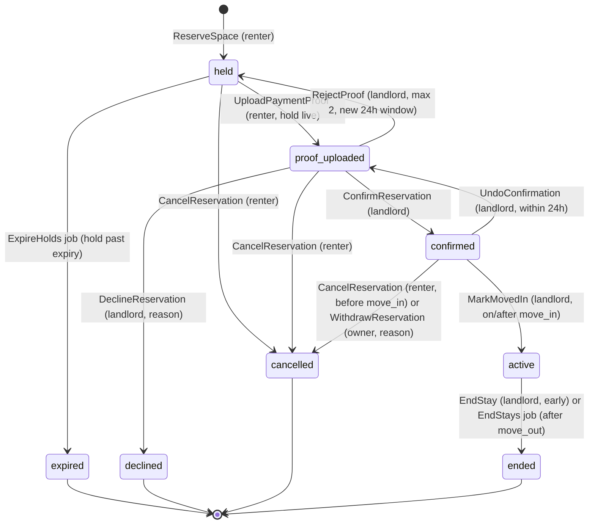

# Reservations: rules, lifecycle and concurrency

The source of truth for how a reservation behaves. Action classes, the transition table in code, and tests must match this file.

## Vocabulary

- **Space**: the one reservable unit. A private room or apartment unit has one space ("Whole room"). A shared room has one space per bed ("Bed A", "Bed B", …). See [ADR 0004](adr/0004-space-as-the-reservable-unit.md).
- **Stay**: the date range `[move_in, move_out)`. `move_out` is exclusive, so a lease ending Jun 1 and one starting Jun 1 don't overlap.
- **Overlap**: `existing.move_in < new.move_out AND new.move_in < existing.move_out`.
- **Blocking reservation**: one that makes its space unavailable for overlapping dates:
  - `held` **and** `hold_expires_at > now()` (a **live hold**; at exactly `hold_expires_at` it no longer blocks)
  - `proof_uploaded`, `confirmed`, `active`

  This lives in one place, `Reservation::scopeBlocking()`, and the availability search reuses the same predicate. Correctness never depends on a job running on time. "Now" is bound from Laravel's clock, never SQL `NOW()`, so tests that freeze time see the same thing as the database.
- **Open reservation** (for the per-renter limits): a live `held` or a `proof_uploaded` reservation (`Reservation::scopeOpenForRenter()`). Expired holds (whether or not the job has run), `confirmed`, `active` and final reservations don't count.
- **Business date**: "today" is the calendar date in `Asia/Manila`, from `BusinessDate::today()` ([ARCHITECTURE](ARCHITECTURE.md#time)).

## Booking rules

| Rule | Value | Enforced in |
| --- | --- | --- |
| Renter picks a room, not a space | Server assigns the lowest-id non-archived space with no blocking overlapping reservation | `ReserveSpace` |
| Only renters reserve | A landlord user is rejected | `ReserveSpace` |
| Move-in window | today … today + 90 days, both inclusive, with "today" in `Asia/Manila` | `ReserveSpace` (form request validates shape only) |
| Lease length | 1–12 whole months; `move_out = move_in->addMonthsNoOverflow(n)` (Jan 31 + 1 month = Feb 28, or 29 in a leap year) | `ReserveSpace` |
| Hold length | 24 hours from creation | `ReserveSpace` |
| Open reservations per renter | at most 2 | `ReserveSpace`, under the renter lock |
| Open reservations per renter per property | at most 1 | `ReserveSpace`, under the renter lock |
| Reserve requests | at most 10 a minute per renter (`throttle:reservations`); the 11th gets the same answer as a broken rule | Route middleware |
| Reservation fee | Snapshot of `rooms.reservation_fee` (centavos) at reservation time | `ReserveSpace` |
| Property must be published and not archived, account verified, room not archived | Otherwise the room is 404 to renters | Query scope + `ReserveSpace` |
| Gender policy | Not enforced by the system. Shown on the listing; the landlord declines if it doesn't fit | (decision to check) |

When a renter breaks both limits at once, the per-property message wins: it's the one that tells them which reservation to cancel.

### Over HTTP (slice 2.5)

| Route | Who | What |
| --- | --- | --- |
| `GET /listings/{city}/{slug}` | anyone | The listing page (slice 5.1, [ACCESS.md](ACCESS.md#public-pages-slice-51)): each listed room with its rate, fee, deposit and advance months, beds, and the free beds for `?move_in=Y-m-d&months=n` (default today, 6 months), and a reserve form per room. Listed rooms only (`Room::scopeListed()`: room not archived, property published and not archived, account verified), anything else `404`. A renter with an open reservation in a room gets a link to it instead of that room's form |
| `GET /rooms/{room}` | anyone | The 2.5 room page: a `301` to the room's anchor on its listing page, keeping `move_in` and `months`. Listed rooms only, else `404` |
| `POST /rooms/{room}/reservations` | renter, email verified | `StoreReservationRequest` checks the shape only (`move_in` is `Y-m-d`, `months` a whole number), then `ReserveSpace` decides. Success: redirect to `/reservations/{id}`, or `201` JSON (`reservation.id`, `space_id`, `status`, `hold_expires_at`). Broken rule: the `error` flash back on the room page, or `422 {message}` JSON. Guests go to `/login` and come back to the room page; landlords get `403` |
| `GET /reservations/{reservation}` | the reservation's renter | "Your hold": status badge, space, stay, fee, `hold_expires_at` in Manila time. Anyone else's reservation is `404` |

### Rejections

Each broken rule is a domain exception in `app/Exceptions/Domain/` with a user-facing message. They extend `BusinessRuleException`, which renders `422 {"message": …}` for JSON requests and redirects Inertia requests back with the message in the `error` flash (`flash.error`). They aren't logged.

| Exception | When |
| --- | --- |
| `NotARenter` | The user isn't a renter |
| `InvalidLeaseLength` | Not 1–12 months |
| `MoveInOutOfRange` | Move-in before today or after today + 90 (the message names both dates) |
| `RoomNotReservable` | Room archived; property unpublished or archived; account unverified |
| `HoldLimitReached` | Already 2 open reservations, or already 1 open in this property (two messages) |
| `NoSpaceAvailable` | Every non-archived space has a blocking reservation overlapping the dates |
| `HoldExpired` | A renter acts on a `held` reservation past `hold_expires_at` (proof upload) |
| `InvalidTransition` | A status move the [transition table](#transition-table) doesn't have, or expiring a hold that is still live |

## Concurrency

Two locks inside one transaction, always taken in the same order to avoid deadlocks:

1. **Renter row** (`users` `FOR UPDATE`). This serializes one renter's own requests, so two parallel requests can't both pass the 2-open / 1-per-property check.
2. **Room row** (`rooms` `FOR UPDATE`). This serializes every reservation for the room, so two renters queue at the lock instead of racing for the last space.

Then: check the room is reservable, check the renter limits, find the first free space, insert the hold. The transaction makes up to 3 attempts on a deadlock or lock wait timeout.

**Every read inside the transaction is a locking read** (`FOR UPDATE` or `LOCK IN SHARE MODE`), and the two locks come first. Under InnoDB's `REPEATABLE READ`, a plain `SELECT` would fix a read snapshot; a request that then waited at the room lock would keep reading that snapshot and miss the hold the lock holder just inserted. Locking reads always see the latest committed rows. For the same reason the checks are separate queries, not `NOT EXISTS (…)` subqueries: a locking clause on the outer query doesn't make its subquery a locking read. [ADR 0001](adr/0001-room-lock-vs-exclusion-constraint.md) has why this instead of `READ COMMITTED`; `tests/Feature/Reservations/LockingTest.php` pins the rules down. This works the same on MySQL, MariaDB, PostgreSQL and SQL Server. [ADR 0001](adr/0001-room-lock-vs-exclusion-constraint.md) compares it with a PostgreSQL exclusion constraint.

**Proven over real parallel HTTP** by the concurrency suite (`tests/Concurrency`, slice 2.5): T1, T2 and T8b, five rounds each, against a multi-threaded server, in CI on MySQL and MariaDB. Each race also proves that every request was inside the server before the first one finished. With either lock removed the suite fails ([ADR 0001, Evidence](adr/0001-room-lock-vs-exclusion-constraint.md#evidence-slice-25)).

**The landlord side takes the same room lock.** `ArchiveSpace`, `ArchiveRoom`, `UpdateRoom` (fee, type), `AddSpace`, `RenameSpace` and `UnarchiveSpace` lock the room row first and only then read, with locking reads, so an archive and a hold are strictly one after the other: if the hold committed first, the archive sees it and is refused; if the archive committed first, `ReserveSpace` finds the room archived (`RoomNotReservable`). `ArchiveProperty` locks every room of the property by id, then the property row, the same order as `ReserveSpace` (room, then a locking read of the property), so the two can't wait on each other. Proven in `tests/Feature/Landlord/ArchiveLockingTest.php` and by the archive race in the concurrency suite ([ADR 0001](adr/0001-room-lock-vs-exclusion-constraint.md#archive-versus-reserve-slice-41)).

Every other action that changes a reservation's status (confirm, decline, cancel, upload proof…) locks the **reservation row** and re-reads its status before applying the transition. Two caretakers confirming and declining at the same moment can't both win.

## Lifecycle

"Landlord" in the diagram means owner or caretaker unless it says owner. See [ACCESS.md](ACCESS.md).

### Transition table

Every arrow is one action class. The transition table (`ReservationStatus::canTransitionTo()`) rejects any move not listed here with a `422` and a clear message. Actions call `Reservation::assertCanMoveTo()` on the locked row, which applies the table plus the guards that depend on the hold's expiry: `held` → `proof_uploaded` needs a live hold (`HoldExpired` otherwise), `held` → `expired` needs an expired one. `held` → `cancelled` is allowed either way.

| From | To | Action | Actor | Guard | Side effects |
| --- | --- | --- | --- | --- | --- |
| — | held | `ReserveSpace` | renter | rules above | email renter: hold + payment instructions |
| held | proof_uploaded | `UploadPaymentProof` | renter (own) | `hold_expires_at > now()` | email landlord members |
| held | expired | `ExpireHolds` | system | `hold_expires_at <= now()` | email renter |
| held | cancelled | `CancelReservation` | renter (own) | — | — |
| proof_uploaded | held | `RejectProof` | owner, caretaker | `proof_rejections < 2`; reason required | new `hold_expires_at = now()+24h`; proof marked rejected; email renter |
| proof_uploaded | confirmed | `ConfirmReservation` | owner, caretaker | — | proof marked accepted; email renter |
| proof_uploaded | declined | `DeclineReservation` | owner, caretaker | reason required | email renter; refund recorded per house rule |
| proof_uploaded | cancelled | `CancelReservation` | renter (own) | — | email landlord; refund recorded per house rule |
| confirmed | proof_uploaded | `UndoConfirmation` | owner, caretaker | `decided_at > now()-24h`, before move_in | email renter |
| confirmed | active | `MarkMovedIn` | owner, caretaker | `today >= move_in` | — |
| confirmed | cancelled | `CancelReservation` | renter (own) | `today < move_in` | email landlord; refund recorded |
| confirmed | cancelled | `WithdrawReservation` | owner | reason required, `today < move_in` | email renter; refund recorded |
| active | ended | `EndStay` | owner, caretaker | sets `move_out = max(today, move_in + 1 day)` if earlier than planned | frees the space from that date |
| active | ended | `EndStays` | system | `move_out <= today` | — |

Every landlord-side transition writes an `audit_logs` row.

### Correction paths

| Mistake | Correction |
| --- | --- |
| Renter uploads a blurry or wrong-amount proof | Landlord uses **RejectProof**. The renter gets a fresh 24h window, at most twice, then the landlord must decline |
| Landlord confirms by mistake | **UndoConfirmation** within 24h and before move-in |
| Landlord declines by mistake | No undo. The space is free again and the renter can reserve again; the audit log keeps the history (decision to check) |
| Renter changes their mind | **CancelReservation** before move-in |
| Landlord can't honour a confirmed booking | Owner uses **WithdrawReservation** with a reason |
| Renter leaves early | **EndStay** shortens `move_out` |
| Moved-in marked by mistake | Not supported in v1; backlog |

### Refunds

The system never moves money. When a reservation is declined, cancelled or withdrawn after proof was uploaded, the landlord records `fee_refunded` (yes/no) and an optional note. The listing shows the property's refund rule as free text from `properties.house_rules`.

### Unanswered proofs

A `proof_uploaded` reservation keeps blocking the space, because the renter has paid. Landlord members get a reminder email after 24h and again after 48h, and the dashboard flags it as overdue. The system never declines a paid reservation automatically (decision to check).
